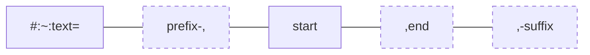

Title: #:~:text=
Date: 2026-11-28 12:26 +0900
Category: Tech
Tags: BlogBlog 同樂會, TIL
Slug: text-fragments
Cover: /images/meme/avemujica-shocked.jpg
Authors: Wei Lee
Lang: zh-tw
Status: draft

如同[#:~:text=](https://lq7.tw/chat/cool-text-url/#:~:text=%23%3A~%3Atext%3D)所提到
LQ7 大大為了跟我解釋[駿恆老師](https://www.dragon-art.tw/)是誰，所以貼了[#:~:text=駿恆老師的課](https://yuncolorblog.com/about/#:~:text=駿恆老師的課)給我看
我大為震撼

<!--more-->


/// caption
© BanG Dream! Project｜出自 [《BanG Dream! Ave Mujica》](https://ani.gamer.com.tw/animeVideo.php?sn=41638)
///

難道是特定部落格才有的設計嗎？！

做了一些測試才發現其實大多網站都支援，表示這很有可能是瀏覽器層級的功能
該不會是 W3C 的標準吧？

問了一下 AI 找到了 [URL Fragment Text Directives](https://wicg.github.io/scroll-to-text-fragment/) 這份文件
答案是


/// caption
© BanG Dream! Project｜出自 [《BanG Dream! It's MyGO!!!!!》](https://ani.gamer.com.tw/animeVideo.php?sn=34517)
///

它是一份由 WICG (Web Platform Incubator Community Group) 提出的規格草案
簡單來說應該可以理解成由社群提出並孵化的 Web 技術提案
雖然沒有實際進入標準，但各大瀏覽器都已經支援了

```text
#:~:text=[prefix-,]start[,end][,-suffix]
          context  |--match--|  context
```



整個文法中總共有

* prefix（選用）
* start（必要）
* end（選用）
* suffix（選用）

開始 start 跟結束 end 都算好理解
就是標記開始 start 跟結束 end 的文字
像是[#:~:text=後記,10](https://lq7.tw/chat/cool-text-url/#:~:text=後記,10)就會從 `後記` 開始標記到第一個出現的 `10` 結束
如果沒有結束的點，就會只標記開始（e.g., [#:~:text=後記](https://lq7.tw/chat/cool-text-url/#:~:text=後記)）
只標記結束 `#:~:text=,10` 是無效的

那前綴 prefix 跟後綴 suffix 是幹嘛的？
它們分別是用來指定標記範圍之前跟之後要有什麼文字
與標記範圍之間允許存在任意數量的空白字元
因為之前在 PyCon TW 的審稿有遇過有人放了看起來像是空格，但不是空格的字元
所以要說明一下這裡如何定義「空白字元」：依據 Unicode 的 White_Space 屬性判定
空白字元這個話題滿有趣的，可以再延伸出下一篇文章聊
使用這兩個參數的目的是 **消除歧義**，而且它們不被包含在標記範圍內

以 LQ7 的[#:~:text=](https://lq7.tw/chat/cool-text-url/#:~:text=%23%3A~%3Atext%3D)來說

```markdown
## 後記２（11/26 10:10 更）

...

[^6]: 松旁邊敲10下可以叫出鬼模式算嗎？等等，現在還要敲嗎？😩
```

這裡出現了 3 個 `10`，我要怎麼找出正確的 `敲10下` 的 `10` 呢？

前綴 prefix 的做法是 [#:~:text=敲-,10](https://lq7.tw/chat/cool-text-url/#:~:text=敲-,10)
因為 10 的前面是敲，**要注意的是，不論是前綴還是後綴都必須是[緊鄰](https://wicg.github.io/scroll-to-text-fragment/#:~:text=immediately,the)的**
所以[#:~:text=松旁邊-,10](https://lq7.tw/chat/cool-text-url/#:~:text=松旁邊-,10)因為中間少了一個 `敲`，是不會有效的
或者，如果是走後綴 suffix 的做法，則是 [#:~:text=10,-下可以](https://lq7.tw/chat/cool-text-url/#:~:text=10,-下可以)

沒想到 LQ7 為了介紹駿恆老師，就因此在世界上產生了兩篇部落格文章（歡迎繼續增加）
所以...
沒錯！

> 這是我在「[BlogBlog 同樂會 - 2026 年 11 月](https://blogblog.club/party/)」的投稿文章。本月主題是「[部落格文章（與他們的產地）](https://blog.giveanornot.com/blogblogparty-blog-posts)」，由 [資工小廢物 - JN](https://blog.giveanornot.com/) 主持。如果你有自己的部落格，歡迎一起來參加！

## 我也來後記一下好了
這篇文章總共提到 <https://lq7.tw> 8 次[^1]
不知道 [IndiePing](https://indieping.giveanornot.com/) 有沒有做去重，還是 LQ7 會一口氣收到 8 次通知

## 再來一個後記
[#:~:text=](https://lq7.tw/chat/cool-text-url/#:~:text=Apache%20Airflow%20PMC%20%E6%88%90%E5%93%A1%E3%80%81%E8%87%BA%E7%81%A3%E8%8F%AF%E8%AA%9E%E7%A8%8B%E5%BC%8F%E7%A2%BC%E8%B2%A0%E8%B2%AC%E4%BA%BA%E8%88%87%E7%BF%BB%E8%AD%AF%E8%B2%A0%E8%B2%AC%E4%BA%BA3%E9%83%BD%E4%B8%8D)[^2] 有提到了這麼一件事[^3]
畢竟我負責的部分主要還是後端
至於前端的部分，就要向大家分享我的熱情了


[^1]: 截至目前為止
[^2]: 然後就第 9 次了...
[^3]: Apache Airflow PMC 成員、臺灣華語程式碼負責人與翻譯負責人都不知道
